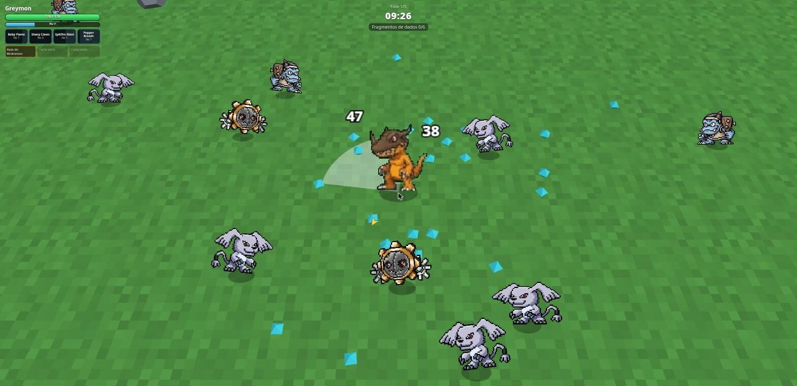

# DigiBonk

Um *survivors-like* de Digimon feito por fã, em 3D com sprites 2D: você entra no mapa com um Digimon Child, enfrenta hordas cada vez maiores, sobe de nível, junta cartas e **escolhe quando digievoluir**. É **diretamente inspirado no [PokéBonk](https://pokebonk.com/)**, trazendo a mesma ideia para o universo Digimon, com as digievoluções simplificadas do Digimon World 1.



> **Status:** protótipo jogável. O motor, as 5 fases, as digievoluções, as cartas e os chefes já funcionam. Sprites, parceiros e equilíbrio ainda estão em andamento.

## Inspiração: PokéBonk

O DigiBonk nasceu da vontade de ter um **[PokéBonk](https://pokebonk.com/) de Digimon**. O PokéBonk, criado por Charcher, é um fan-game de Pokémon no estilo do Megabonk. Ele é a nossa principal referência de jogabilidade e de visual:

- **Visual:** sprites 2D em pé num mundo 3D, com câmera de cima.
- **Combate:** automático, com espaços de ataque; você só se move.
- **Fases:** cada fase tem uma missão que libera o chefe. Você escolhe a hora de enfrentá-lo ou continua farmando, e as hordas pioram com o tempo.
- **Ataques substituíveis:** itens que trocam seus ataques, que aqui viraram as cartas *Slash* do Digimon Tamers.

O que muda é o tema e o que é próprio de Digimon: a **digievolução por escolha**, com requisitos de nível, atributos e itens; os Digiovos e as fusões, como Omnimon e Imperialdramon; e as cartas do Tamers como equipamento.

O código do DigiBonk foi **escrito do zero** (TypeScript + Three.js). Nenhum código ou arte do PokéBonk foi copiado.

## Como funciona uma partida

- **Escolha o parceiro.** Os iniciais são Agumon (Adventure), Veemon (Adventure 02) e Guilmon (Tamers). Gabumon e Wormmon se desbloqueiam encontrando o **ovo** deles durante as partidas.
- **Combate automático.** Cada Digimon tem espaços de ataque com o próprio kit (Pepper Breath, Spitfire Blast...). Você só se move, e os golpes saem sozinhos.
- **Level up.** A cada nível você escolhe entre aprender um golpe novo, melhorar um golpe ou aumentar um atributo (Vida, Ataque, Defesa, Velocidade, Cérebro).
- **Digievolução por escolha.** Quando os requisitos são cumpridos (nível, atributos, itens), aparece o aviso "Digievolução disponível!". Você aperta **E** quando quiser e escolhe o caminho. Algumas formas exigem itens especiais:
  - os Digiovos da Coragem e da Amizade levam o Veemon a Flamedramon e Raidramon;
  - os dados de fusão liberam Omnimon e Paildramon;
  - o Blue Card leva o WarGrowlmon a Gallantmon.
- **Cartas do Digimon Tamers.** Há 3 espaços para cartas passivas, como Garras do Gatomon ou Armadura do Andromon. As cartas *Slash* substituem um dos seus ataques.
- **5 fases de 10 minutos.** Cumpra a missão da fase para liberar o chefe (Devimon, Etemon, Myotismon, Kimeramon, Piedmon). Você pode enfrentá-lo ou continuar farmando. Se o tempo acabar, chegam as **hordas insanas**.

## Controles

| Ação | Teclado | Controle |
|---|---|---|
| Mover | WASD / setas | D-pad / analógico |
| Confirmar | Enter / Espaço | A |
| Voltar | Backspace | B |
| Digievoluir | E | Y |
| Pausar | Esc | Start |
| Opções rápidas nos menus | 1, 2, 3 | — |

Os controles podem ser remapeados no menu **Controles**.

## Rodando localmente

Requisitos: **Node.js 22+**.

```bash
npm install        # o .npmrc já liga legacy-peer-deps
npm run dev        # http://localhost:5173
```

| Script | O que faz |
|---|---|
| `npm run dev` | servidor de desenvolvimento (Vite) |
| `npm run build` | checagem de tipos + build de produção em `dist/` |
| `npm test` | testes (Vitest) |
| `npm run sprites:vpet` | regera as tiras de sprite em `public/sprites/` |

### Modo debug (só em desenvolvimento)

Abra `http://localhost:5173/?debug` e comece uma partida. Aparece um painel (**F2** mostra/esconde) com botões para:

- evoluir para qualquer forma (sem requisitos);
- +1 nível;
- dar qualquer carta ou item;
- curar, ficar invencível e matar todos (inclui o chefe);
- velocidade 2× (liga/desliga), para ver a troca de caminhada para corrida.

Também dá para combinar flags na URL: `?debug=xp10,items,spawn600` (10× XP, só itens nos baús, 600 inimigos de uma vez para testar desempenho).

## Banco de dados

Os dados do jogo vivem num banco **SQLite** versionado por migrations. Ele já nasce pensando no servidor futuro: as migrations usam SQL portátil, que também roda em PostgreSQL. O banco guarda:
- Digimon, com estágio, atributo, elemento e status base;
- golpes;
- evoluções;
- itens;
- cartas;
- inimigos e chefes;
- as tabelas de vantagem.

```
db/migrations/   esquema (001_esquema.sql, 002_..., aplicadas em ordem)
db/seeds/        conteúdo (001_tipagem.sql: atributos, elementos e vantagens; 002_conteudo.sql: o resto)
db/digibonk.db   gerado, não vai para o git
src/data/generated/gamedata.ts   gerado a partir do banco, vai para o git; o jogo importa daqui
```

| Comando | O que faz |
|---|---|
| `npm run db:build` | recria o banco do zero (migrations + seeds) e gera `src/data/generated/gamedata.ts` |
| `npm run db:migrate` | aplica só as migrations pendentes |
| `npm run db:seed` | aplica só os seeds pendentes |

**Para mudar um dado** (status, golpe, carta...): edite o `.sql` em `db/seeds/` e rode `npm run db:build`.

**Para mudar o esquema:** crie uma migration nova com o próximo número (ex.: `002_loja.sql`) usando só `TEXT`, `INTEGER` e `DOUBLE PRECISION` (não `REAL`, que tem 4 bytes no PostgreSQL) e chaves explícitas. Nunca edite uma migration que já foi aplicada em outro lugar.

Requer **Node 22**, que traz o `node:sqlite` embutido, sem dependência extra.

### Regras que vêm do banco

- **Crescimento por nível:** `status = base × (1 + 0,005 × (nível − 1))`, ou seja, +0,5% do base por nível. A taxa fica por Digimon.
- **Vantagem:** dano × (atributo do atacante contra o do alvo) × (elemento do golpe contra o do alvo).
  - **Atributos:** Vacina > Vírus > Dados > Vacina.
  - **Elementos:** 11, cada um com suas vantagens, na tabela `element_matchups`.
  - Vale para os seus golpes e para os ataques dos inimigos.
- **Cartas:** as passivas dão bônus em %, e pegar a mesma carta de novo na partida sobe o nível dela, até 10. A carta Slash repetida sobe o nível do golpe.

## Estrutura

```
src/
  core/     RNG com seed, loop de passo fixo, entrada (teclado + gamepad), save
  data/     dados do jogo (gerados do banco em data/generated) e ajustes (tuning)
  sim/      simulação pura e determinística: combate, hordas, fases, chefes, loot
  render/   Three.js: cena, mapa, billboards com sprites, animação procedural
  ui/       HUD, menus, modais de escolha, painel de debug
tools/sprites/  recorte das folhas de sprite → tiras + manifest.json
tools/db/       executor de migrations/seeds e exportador banco → dados do jogo
db/             migrations e seeds (SQL)
tests/      testes da simulação, render e UI
docs/superpowers/  documento de design e planos de implementação
```

A simulação (`src/sim`) não conhece Three.js nem o DOM. Isso permite testar uma partida inteira de forma determinística.

## Sprites

Cada Digimon é uma **tira horizontal** de quadros em `public/sprites/<id>.png`. O `manifest.json` diz o papel de cada quadro:

| Papel | Uso |
|---|---|
| `walk1..N` | caminhada de lado (até 24 quadros) |
| `walkup1..N` / `walkdown1..N` | caminhada de costas / de frente |
| `walkdiagup1..N` / `walkdiagdown1..N` | caminhada nas diagonais (com o lado e o espelhamento, são 8 direções) |
| `run…` (mesmos sufixos) | corrida: usada quando a velocidade chega ao dobro da inicial |
| `idle1`, `idleup`, `idledown`, `idlediagup`, `idlediagdown` | parado, em cada direção |
| `hurt1..N` | dano (toca uma vez a cada golpe, com intervalo mínimo) |
| `death1..N` | morte (toca uma vez e segura o último quadro) |

Quem não tem quadros de caminhada desenhados ganha uma animação procedural: pulinho e balanço ao andar, respiração parado.

### Digimon World 3 (formas Child)

Agumon, Veemon e Guilmon usam os **sprites de campo do Digimon World 3** (PS1), assim como os inimigos Bakemon e Guardromon: 5 direções com caminhada (4–5 quadros) e corrida (5–6 quadros), ampliados 2× sem borrar (`tools/sprites/build-dw3.ts`). As folhas originais ficam em `assets-src/sprites/dw3/`.

### Folhas geradas por IA (evoluções)

Greymon e MetalGreymon usam folhas geradas no Gemini. Para recortar uma folha nova:

```bash
# lista as células detectadas (índice x,y,w,h)
tools/sprites/cut-gemini.sh --cells minha-folha.jpeg

# recorta: id, folha, escala %, e papel:célula[:flip] para cada quadro
tools/sprites/cut-gemini.sh greymon greymon.jpeg 75 walk1:3 walk2:4 idle1:31 hurt1:44

npm run sprites:vpet
```

O jogo assume que os sprites de lado **olham para a esquerda**. Use `:flip` nos quadros que vierem virados.

Os demais Digimon e os inimigos usam sprites de V-pet (Vital Bracelet / Pendulum Color).

## Próximos passos

- Os 8 parceiros desbloqueáveis restantes (Patamon, Tentomon, Armadillomon, Gatomon, Terriermon, Renamon...) com as linhas até o Mega.
- Folhas de sprite completas para todas as formas jogáveis.
- Loja entre partidas para comprar melhorias.
- Retratos dos Digimon nos menus e tela de créditos.

## Créditos e aviso legal

DigiBonk é um **projeto de fã, sem fins lucrativos e sem vínculo** com a Bandai Namco, a Toei Animation ou qualquer detentor dos direitos. Digimon, seus personagens, nomes e imagens são © Akiyoshi Hongo, Toei Animation e Bandai.

- **Sprites do Digimon World 3** (Agumon, Veemon, Guilmon, Bakemon, Guardromon): rips de Ragey e Artzei no [The Spriters Resource](https://www.spriters-resource.com/playstation/digiworld3/).
- **Sprites de V-pet:** extraídos dos aparelhos Digimon Vital Bracelet e Pendulum Color (© Bandai), consultados no acervo [humulos.com](https://humulos.com/digimon/).
- **Sprites do Digimon World DS** (em `assets-src/sprites/dwds`, usados nas primeiras versões): rips da comunidade no [The Spriters Resource](https://www.spriters-resource.com/).
- **Folhas do Greymon e do MetalGreymon:** geradas com o Google Gemini a partir de descrições dos personagens.
- **Inspiração:** [PokéBonk](https://pokebonk.com/), de Charcher (a referência principal), Megabonk e Digimon World 1.

Se você é detentor de direitos e quer a remoção de algum material, abra uma *issue*.
